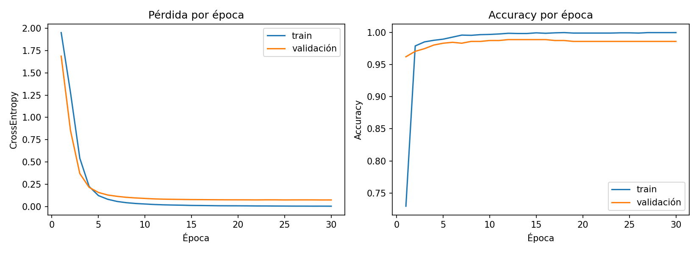

# Clasificador de categorías de productos (Mercado Libre) — Pipeline base en PyTorch

Pre-entrega del Proyecto Final: pipeline de entrenamiento y validación con un clasificador base.
El objetivo no es la complejidad del modelo sino la calidad del pipeline.

## Problema y dataset
Dado el **título** de una publicación de Mercado Libre, predecir su **categoría** (clasificación multiclase, 8 clases).

- Fuente: export de publicaciones propias (`INTEGRALY_17-10.xlsx`). El Excel original **no se versiona** (`data/raw/` está en `.gitignore`) porque contiene datos comerciales.
- `data/dataset.csv`: 3.556 títulos únicos con columnas `id_base`, `titulo`, `categoria`. Se genera con `src/prepare_dataset.py`.
- Las clases son categorías de segundo nivel de Mercado Libre. Se descartó "Hogar > Baños" por solaparse con "Construcción > Baños y Sanitarios".

| Clase | Títulos |
|---|---|
| iluminacion | 655 |
| artefactos_cabello | 645 |
| bazar_cocina | 637 |
| banos_sanitarios | 454 |
| muebles | 399 |
| jardin_aire_libre | 310 |
| peq_electrodomesticos | 299 |
| herramientas_electricas | 157 |

El desbalance se compensa con pesos por clase en `CrossEntropyLoss` (`compute_class_weight("balanced")`).

## Estructura
```
├── data/
│   ├── raw/                 # Excel original (ignorado en git)
│   └── dataset.csv
├── src/
│   ├── config.py            # dispositivo, semillas, hiperparámetros
│   ├── prepare_dataset.py   # Excel -> dataset.csv
│   ├── data.py              # split estratificado + TF-IDF + DataLoaders
│   ├── model.py             # MLPClassifier (nn.Module)
│   ├── train.py             # training loop + evaluate()
│   └── utils.py             # historial y gráficos
├── notebooks/
├── outputs/                 # curvas, historial, reporte (se genera al entrenar)
├── requirements.txt
└── README.md
```

## Cómo ejecutarlo
```bash
python -m venv .venv && source .venv/bin/activate   # en Windows: .venv\Scripts\activate
pip install -r requirements.txt
python -m src.train                  # parámetros por defecto
python -m src.train --epochs 40 --lr 0.0005
```
(Opcional) regenerar el dataset: `python -m src.prepare_dataset data/raw/INTEGRALY_17-10.xlsx`

## Diseño del pipeline
- **Dispositivo**: detección automática CUDA → MPS → CPU. Semillas fijadas en Python, NumPy y PyTorch (`seed=42`).
- **Entrada**: TF-IDF (hasta 5.000 features, unigramas y bigramas), ajustado **solo con train** para evitar fuga de información.
- **Split**: 80 % train / 20 % validación, estratificado por clase.
- **Modelo**: MLP `n_features → 128 → ReLU → Dropout(0.3) → 8` (devuelve logits).
- **Entrenamiento**: Adam, `CrossEntropyLoss` ponderada, batch de 64, 30 épocas. Ciclo explícito: `zero_grad()` → forward → loss → `backward()` → `step()`.
- **Validación**: `evaluate()` separada, con `model.eval()` y `torch.no_grad()`. Registra loss, Accuracy y F1 macro por época.
- La accuracy de *train* se calcula durante la época con Dropout activo, por lo que es levemente pesimista respecto de la de validación.

## Resultados del experimento inicial
> Completar con los valores reales tras ejecutar `python -m src.train`.

- **Versión de PyTorch**: `X.Y.Z` (la imprime el script al iniciar).
- **Dispositivo usado**: `cpu / cuda / mps`
- **learning_rate**: `1e-3`. Es el valor estándar de partida para Adam; con un MLP chico y batch de 64 permite converger en pocas épocas sin oscilar.
- **Métricas finales (mejor época, por val loss)**: loss `…` · Accuracy `…` · F1 macro `…`



### Interpretación de la curva de pérdida
> Completar mirando `outputs/curves.png`. Puntos a comentar:
> - ¿Bajó la pérdida de train durante las épocas? ¿Y la de validación?
> - ¿En qué época se estabiliza la validación?
> - ¿Hay overfitting? (val loss que sube mientras train loss sigue bajando)
> - ¿Qué clases confunde más el modelo? (ver `outputs/classification_report.txt`)

## Limitaciones y próximos pasos
- Un mismo producto puede aparecer con títulos casi idénticos; si caen en train y validación, la accuracy se infla un poco.
- Próximos checkpoints: embeddings/secuencias en lugar de TF-IDF, y categorías de nivel más profundo.
